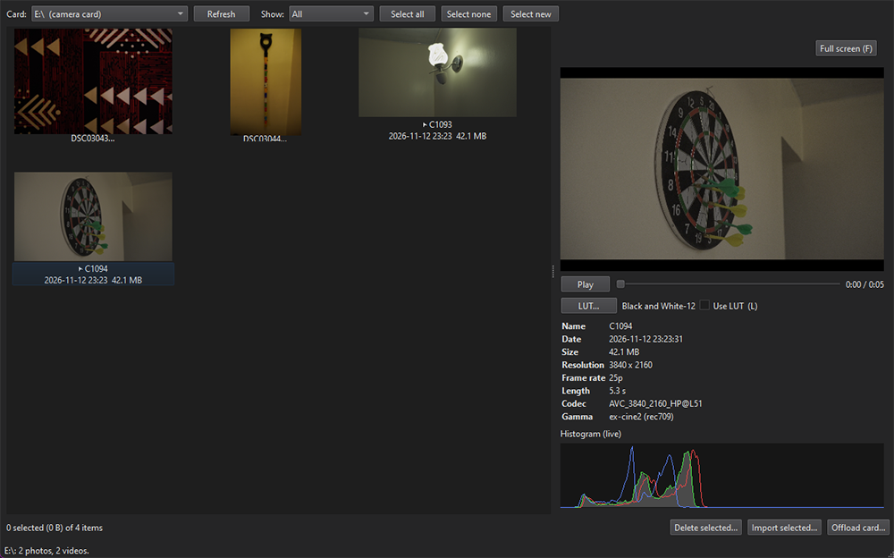

# ZV-E10 Importer

**Browse, preview, import and safely clean the memory card of a Sony ZV-E10 — without "ghost files" and without having to format the card.**

A small, fast desktop app (Windows) with a thumbnail browser, photo/video preview (ARW + JPEG + MP4), LUT preview, verified import to your computer, and a card clean-up that the camera accepts as if it had done it itself.



> ⚠️ **Status:** developed and tested on one ZV-E10 (firmware v2.03). It deletes files, so please read [Safety](#safety) and try it first on a card whose content you have already backed up. Not affiliated with Sony.

---
## Vibe coding warning
This code has been created totally with AI because I'm not able to code. I asked tothe AI to refactor it and improve readability before releasing the final version, but I'm not able to evalute its work.

Even the README has been created by the AI but I checked its coherency because I'm able to understand English, at least.

---

## Contents

- [Why I made this](#why-i-made-this)
- [How the app solves the problem](#how-the-app-solves-the-problem)
- [Features](#features)
- [Installation](#installation)
- [How to use it](#how-to-use-it)
- [Safety](#safety)
- [Known issues](#known-issues)
- [Suggestions for future improvements](#suggestions-for-future-improvements)
  - [Adapting the tool to other Sony cameras](#adapting-the-tool-to-other-sony-cameras)
- [For developers](#for-developers)
- [Credits and license](#credits-and-license)

---

## Why I made this

I own a Sony ZV-E10 and I do not have an SD card reader, so I connect the camera to the computer with the USB cable. Windows then shows two drives: a small one called `PMHOME` (useless for this) and a `USB Drive` that contains the whole card.

My workflow was: connect the camera, **cut** the photos and videos from the card and **paste** them on the computer. And here the trouble started: when I went back to the camera's playback, **the files I had moved were still listed**, shown as *not accessible*. The files were gone, but the camera still believed they existed, like "ghost files".

The ways out were all bad:

- Delete each ghost one by one from the camera's playback menu. With many files it is a nightmare.
- Run **Recover Image DB** in the camera's menu. For me it very often **failed** and the ghosts stayed.
- Switch the camera to **MTP mode**, to let Windows talk to the camera instead of reading the card directly. In practice this was very inconvenient: you cannot *cut* files in Explorer, only copy them, you have to use Windows' own "import pictures and videos" tool, you cannot preview anything, and I never even managed to find out whether it lets you delete the files from the camera.
- **Format the card.** That works, but formatting also erases the custom presets that the camera stores *on the card* (the `SETTINGS` folder), so before every format I had to back that folder up and restore it afterwards.

On top of that, I could not find any simple program to **preview, select and import** files from a ZV-E10 quickly and comfortably.

So I decided to understand where the "ghosts" really live, and to build a tool that moves files off the card **the way the camera expects it**, with a nice and fast interface around it. I am publishing it because I am sure I am not the only ZV-E10 owner with this problem.

---

## How the app solves the problem

> **Words used below**
> - **Ghost files**: files that are gone from the card but are still listed by the camera.
> - **The camera's index (its "database")**: the camera does not look through the card every time you open playback. It keeps its own list of everything on the card, in a folder called `AVF_INFO`. It is a binary file (not readable by humans) in a format Sony has not documented.
> - **Sidecar files**: the small extra files that belong to each video: a thumbnail, a small XML file with its details (and a proxy file if you use proxies).
> - **The catalog**: `MEDIAPRO.XML`, a plain text file in which the camera lists every video clip.

### Where the ghosts come from

When you cut a file in Windows Explorer, Windows removes the file but nothing tells the camera. The camera still has the file in its index, so it still lists it in playback, and you get a ghost. By comparing "snapshots" of the card before and after each operation, I found that the camera keeps traces of every clip in **three places**, and Explorer only removes the video file itself:

| Place | What it is | What Explorer leaves behind |
|---|---|---|
| `PRIVATE/M4ROOT/MEDIAPRO.XML` | The catalog: a text file listing all video clips | The entry of every clip you moved |
| `PRIVATE/M4ROOT/THMBNL/` (and `SUB/` for proxy files, which I did not have enabled) | Thumbnail (and proxy) of each clip | The thumbnail JPGs |
| `AVF_INFO/` | The camera's index (database) of every photo and clip | Entries for every photo and clip |

- The **index (`AVF_INFO`)** is what makes the camera *list* a file after you removed it: those are the ghosts you see in playback.
- The **leftover catalog entries and thumbnails** are, in my tests, what made **Recover Image DB fail**. That is the camera menu command that rebuilds the index from the files that are really on the card.

### Why Recover Image DB failed for me

What I observed on my camera:

1. After moving files with Explorer, I deleted the ghosts from the camera's playback menu, hoping that this cleans everything. The camera removed the ghosts from its index but **left the catalog entries and the thumbnails untouched** (the snapshot comparison showed these files were identical before and after).
2. I then ran *Recover Image DB*: it reported an error and **could not repair it** (as it had done most of the times before).
3. When I removed those leftover catalog entries and thumbnails by hand and ran *Recover Image DB* again, it **succeeded**, and the ghosts were gone. The same happened in later tests, including the ones done with this app.

So the leftovers are very probably the cause. I want to be honest about how solid this is: it comes from one camera and a handful of runs; I could not see the camera's own reason for the error; and I did not test whether the catalog entries, the thumbnails, or both are responsible (the app removes both).

### What the app does about it

1. **Deletes a clip or photo completely**: the media file *and* every sidecar file (details, thumbnail, proxy, the JPEG that goes with a RAW), and removes the clip's entry from the catalog.
2. **Checks its copies before deleting anything**: after copying a file to your computer, the app compares the copy with the original to make sure they are identical (it compares a digital "fingerprint" of both, so a single wrong byte would be noticed). Only files that passed this check are removed from the card.
3. **Resets the camera's index when the card ends up empty.** I found that when the `AVF_INFO` folder is missing, the camera simply creates a brand-new, empty index at the next power-on (it does *not* look at the card's files). On an empty card that is exactly what you want, so the app removes `AVF_INFO` after emptying the card. Result: the card is clean, the camera starts normally, no ghosts, no formatting, **your presets are never touched**.
4. **If some files stay on the card**, the app does not edit the camera's index itself: the format is complicated and undocumented, and a mistake could leave the camera unable to read the card (see [For developers](#for-developers) for what I found out about it). Instead, it asks you to do a one-time repair inside the camera: **Recover Image DB** (*Setup › Page 4*), which makes the camera rebuild its index from the files that are really there. This works because step 1 left the card consistent.

> In short: the app only removes files and text-file entries, and (on an empty card) deletes the index folder so the camera regenerates it. It never writes into the camera's index.

---

## Features

**Browsing and preview**
- Thumbnail grid of photos (ARW, JPEG, RAW+JPEG pairs shown as one item) and videos (the camera's own thumbnails). Fast, also over the camera's USB cable.
- Photo preview with exposure data (shutter, aperture, ISO, focal length) and a histogram. ARW files are shown through their embedded JPEG preview: instant, no RAW decoding.
- Video player inside the window, with a click-to-seek timeline, a **live histogram**, and a **slow-motion** option for 50/60/100/120 fps clips (plays them at 25/30 fps).
- **Full screen** for photos and videos.
- **LUT preview** for photos and videos (a LUT is a colour "look" file, `.cube`, used in video editing — for example to see how LOG footage will look once graded): pick any LUT, switch it on and off, never modifying the LUT or your files. LUTs found in DaVinci Resolve / Adobe folders are listed for you, with their folder structure.

**Managing the card**
- **Import** selected items to a folder of your choice (by date and type, by date, or flat), with a check that every copy is identical to the original, automatic renaming of name clashes, and an option to remove the files from the card afterwards.
- **Delete** selected items from the card, with all their sidecar files.
- **Offload card**: import the items you select, permanently delete all the others, empty the card and reset the camera database in one go.
- **Clean leftovers**: repairs a card where files were already cut in Explorer (removes orphan thumbnails and stale catalog entries).
- "Imported" markers and a *Not imported yet* filter, so you can select only new files.
- Backup of the camera database, catalog and presets before a reset.

**Also included**
- A command-line version of everything (`python -m zvcard`), with a `--dry-run` option (a rehearsal that shows what would happen and changes nothing).
- Developer tools to snapshot and compare cards, to help adapt the tool to other cameras.

---

## Installation

You need **Windows** and **Python 3.10 or newer** ([python.org](https://www.python.org/downloads/) — tick *Add Python to PATH* during setup).

```bat
git clone https://github.com/Taccimor/zve10-importer/
cd zve10-importer
pip install -r requirements.txt
```

Start the window:

```bat
run_gui.bat
```
or `python -m zvcard.gui`.

The command line and the tests only need `Pillow`; the window needs `PySide6` too (both are in `requirements.txt`).

---

## How to use it

1. **Connect the camera** with the USB cable (USB connection mode: *Mass Storage*), or put the card in a card reader. Start the app. The card appears in the top box (for the camera it is the drive called *USB Drive*, not *PMHOME*). If you connect it after starting the app, press **Refresh**. *Choose a folder…* lets you open a copy of a card stored on your disk.
2. **Browse.** Click an item to preview it. Use the filter (*All / Photos / Videos / Not imported yet*) and *Select all / none / new*. A ✓ marks items you already imported.
3. **Choose what to do:**

| Button | What it does |
|---|---|
| **Import selected…** | Copies the selected items to your computer and checks that every copy is identical to the original (you can choose *Compare contents* — the safest —, *Compare size only* — faster — or *No check*). Optional checkbox: remove them from the card afterwards. |
| **Delete selected…** | Permanently deletes the selected items from the card (with confirmation). Nothing is copied. |
| **Offload card…** | Selected items are **imported**; **every other item is permanently deleted**; then the card is emptied and the camera database reset. Asks for explicit confirmation. |
| **Clean leftovers** | Only shown when the card has leftovers from files cut in Explorer. Removes them. Afterwards run *Recover Image DB* once on the camera. |

4. **Finish.** The app tells you what to do next:
   - *Card is empty and reset* → nothing else to do; the camera builds a fresh database when you turn it on.
   - *Some media remains on the card* → on the camera: **Menu › Setup › Page 4 › Recover Image DB** (once).

### Keyboard shortcuts

| Key | Action |
|---|---|
| `F` or `Ctrl+F` | Full screen on/off |
| `Space` | Play / pause the video |
| `Shift+←` / `Shift+→` | Seek −5 s / +5 s |
| `L` | LUT on/off |
| `S` | Slow motion on/off (50/60/100/120 fps clips) |
| `Ctrl+A` | Select all |
| In full screen: `←` / `→` | Previous / next item |
| In full screen: `Esc`, `F`, double-click | Leave full screen |

### Slow motion

For clips shot at 50 or 60 fps the checkbox plays them at half speed (25/30 fps); for 100 or 120 fps at quarter speed (25/30 fps). The audio is muted while it is on. The checkbox only appears for those frame rates, and your choice is remembered.

### LUTs

Press **LUT…**: the dialog lists the LUTs found in the DaVinci Resolve and Adobe (Premiere / After Effects) folders, folders you add yourself (keeping their sub-folder structure), and the ones you used recently. You can also browse for any `.cube` file. LUT files are only **read**, never copied or moved. The small grey text next to the LUT shows the preview frame rate actually achieved.

### Command line

```bat
python -m zvcard detect                              :: find the card drive
python -m zvcard scan E:\                            :: list what is on the card
python -m zvcard offload E:\ D:\Camera --dry-run     :: rehearsal, changes nothing
python -m zvcard offload E:\ D:\Camera               :: copy + verify + empty the card + reset the database
python -m zvcard offload E:\ D:\Camera --keep-on-card
python -m zvcard clean E:\                           :: repair a card where files were cut in Explorer
python -m zvcard delete E:\ DSC02996 C1079           :: delete specific items
python -m zvcard reset E:\                           :: reset the database of an EMPTY card
```

Where things are stored: settings in the registry (`HKEY_CURRENT_USER\Software\ZVCardTool\ZVCardTool`), the import history and the pre-reset backups in `%APPDATA%\ZVCardTool\`.

---

## Safety

The tool is built around a few strict rules, all covered by automated tests:

- Nothing is removed from the card after an import **unless its copy was checked and found identical to the original**.
- **Read-only files are never deleted** (they are reported and left on the card).
- `MEDIAPRO.XML` is only edited for clips whose MP4 is really gone, and the result is parsed as XML before being written.
- The camera database folder (`AVF_INFO`) is removed **only when the card holds no media at all**. If anything else is found (unknown files, files from other devices), the reset is refused.
- A **backup zip** (database, catalog, presets) is created before a reset.
- `PRIVATE/SONY/SETTING` (your presets) is **never modified**.
- It only works on cards whose catalog says `systemKind="ZV-E10"`.
- Every command-line command that changes the card (`offload`, `delete`, `clean`, `reset`) has `--dry-run`; deletions in the window always ask for confirmation.

Still, this program deletes files. **Back up what matters, and try it first with a card whose content you have already copied.** You use it at your own risk (see the license).

---

## Known issues

Technical notes for users and contributors.

**Scope and compatibility**
- Tested only with **one ZV-E10** (firmware v2.03), in USB mass-storage mode, on Windows. Other Sony models (even ones that share the `M4ROOT` layout) are refused by the `systemKind` check on purpose; see [Adapting the tool to other Sony cameras](#adapting-the-tool-to-other-sony-cameras).
- Card detection (`scan.find_cards`) only scans Windows drive letters. On macOS/Linux, use *Choose a folder…*; the rest is untested there. The attribute handling for removing the read-only/system flags is Windows-specific.

**The camera database is not edited**
- When *some* media stays on the card, the camera database still lists the removed items until you run *Recover Image DB*. This is by design (see [For developers](#for-developers)), not a bug.
- The automatic reset relies on a camera behaviour (a missing `AVF_INFO` is recreated empty at the next power-on) verified on the author's camera/firmware only. If another firmware instead refuses to boot or shows a database error, *Recover Image DB* on the empty card fixes it; formatting is the last resort.
- If another program (an Explorer window showing the card, antivirus, indexer) holds `AVF_INFO` open, Windows leaves the folder in a "delete pending" state. The tool waits 5 s and then reports it; closing the window and re-plugging the card releases it.

**Files and verification**
- **Protected images**: only the read-only file attribute is honoured. The in-camera "protect" flag lives in the camera database, and I did not verify that it is mirrored as a file attribute. Protected shots may therefore be deleted if you select them.
- The *Compare contents* check (a BLAKE2 checksum, i.e. a digital fingerprint of the file) re-reads the copied file, but the read may be served from the OS file cache, so it proves the copy process worked, not that the destination disk will hold the data.
- "Already imported" tracking identifies a file by *name + size + modification time (seconds)*. After a re-format with numbering reset, a different file with the same triple would be wrongly marked (very unlikely).
- `MEDIAPRO.XML` is edited with a regular expression (to keep the camera's exact formatting) and validated by parsing afterwards. Unusual content (comments or CDATA containing `<Material`) is not handled. The camera rewrites the file in place padded with spaces; the tool writes the shorter file (tested OK with the camera).
- Cancelling an import is granular to a 4 MB chunk; deleting cannot be cancelled once started.

**Preview**
- RAW photos are previewed through the **embedded 1616×1080 JPEG**, not a real RAW render; there is no 100 % zoom. HEIF (`.HIF`) files are not previewable (no HEIF decoder bundled): a placeholder is shown. No ICC colour management (sRGB assumed).
- Video playback relies on Qt's multimedia backend (FFmpeg on Qt ≥ 6.5). Tested with the ZV-E10's XAVC S H.264 4K/HD files with PCM audio only. "Slow & Quick" clips (file written at a normal rate) are not conformed, because the decision uses `formatFps`, not `captureFps`.
- **LUT preview is approximate**: the LUT is applied on the CPU (Pillow `Color3DLUT`, trilinear) to 8-bit RGB frames *after* Qt's YUV→RGB conversion, so it is not colour-managed (range/matrix handling is Qt's), there is no 10-bit/HDR/HLG handling, and `DOMAIN_MIN/MAX` other than 0–1 is ignored for 3D LUTs. Frames are graded at the displayed size (automatically smaller if the PC is slow), reaching roughly 25–35 fps depending on the CPU; 100/120 fps clips cannot be graded in real time (use *Slow motion* with them). Only `.cube` is supported (no `.3dl`, `.look`).
- The live histogram is computed from frames downscaled to ≤ 320 px, about 8 times per second.

**Scalability**
- Every grid item keeps its thumbnail as a decoded icon (~130 KB each): a card with thousands of files uses a few hundred MB. There is no virtualisation or on-disk thumbnail cache.
- No automated tests run against a real Qt (see [For developers](#for-developers)).

---

## Suggestions for future improvements

A list for developers who want to contribute. Roughly ordered by value.

### Adapting the tool to other Sony cameras

The tool refuses cameras other than the ZV-E10 because **I could only verify the ZV-E10's behaviour**. Many Sony XAVC S cameras share the same folder layout, so adaptation may be small — but each claim below must be *checked*, not assumed. The method is to take **snapshots** of the card after each operation and compare them.

**What probably changes between models** (hypotheses to verify)

| Topic | ZV-E10 behaviour | To check on another camera |
|---|---|---|
| Model string | `systemKind="ZV-E10"` in `PRIVATE/M4ROOT/MEDIAPRO.XML` | The value your camera writes (→ `scan.SUPPORTED_MODELS`) |
| Video layout | `M4ROOT/CLIP/Cnnnn.MP4` + `CnnnnMnn.XML`, `THMBNL/CnnnnTnn.JPG`, `SUB/CnnnnSnn.MP4` | Same names? Different digits/suffixes? (→ regexes in `scan.py`) |
| Photo layout | `DCIM/100MSDCF/DSCnnnnn.ARW/.JPG` | Other folder names, `.HIF`, other RAW extensions (→ `PHOTO_EXT`) |
| Catalog | `MEDIAPRO.XML` lists only videos, with `<Material>` blocks | Same schema? Are photos listed too? |
| Camera database | `AVF_INFO/` with `AVIN0001.INP/.BNP/.INT`, `PRV00001.BIN` | Same folder/file names and sizes? |
| Missing database | A missing `AVF_INFO` is recreated **empty** at power-on (no scan) | **Critical**: same behaviour? |
| Recover Image DB | Fails while stale catalog entries/thumbnails exist; passes after cleaning them | Same cause? |
| AVCHD cameras | – | Older/AVCHD models use `PRIVATE/AVCHD/BDMV/…` and `MP_ROOT`: a different layout, needs new code |

**The snapshot protocol**

Use a **spare card** (or one you have fully backed up), with the camera set to the connection mode you will use. Install Python and Pillow, and take every snapshot with the same tool:

```bat
python tools/card_snapshot.py --root E:\ --name 1_clean
```

It *only reads* the card and writes a ZIP with: every file up to 5 MB (databases, XML, thumbnails, presets…), the **whole `AVF_INFO` folder whatever its size**, a `MANIFEST.csv` listing *every* file (with size, time and checksum) and an `INFO.txt`.

Between snapshots, **turn the camera off / disconnect it** before using it again, never run *Recover Image DB* unless a step says so, and write down what the camera's playback shows at each step.

| # | Step | Snapshot | Note what you see |
|---|---|---|---|
| 1 | Format the card **in the camera** (back up your presets first). | `1_clean` | – |
| 2 | Shoot 3 photos (RAW+JPEG if available) and 3 videos (+ proxy if available). Shoot them alternately (photo, video, photo, video…). | `2_shot` | – |
| 3 | **Explorer cut:** copy everything to the PC, then delete the files from the card in Explorer (all the media files and *only* them). Reconnect the camera. | `3_ghosts` | Do ghosts appear in playback? What does the camera say? |
| 4 | In the camera, delete the ghosts from the playback menu. | `4_ghosts_deleted` | Then run *Recover Image DB*: error? repaired? |
| 5 | Repeat 1–3 to recreate the ghost state, then run the tool's cleaner: `python -m zvcard clean E:\` *(after adding your camera's model, see below)* — or do the same by hand: delete the thumbnails/sidecars and remove the clips' `<Material>` blocks from `MEDIAPRO.XML`. Do **not** delete the ghosts in the camera. Run *Recover Image DB*. | `5_cleaned` | Does it pass? Are the ghosts gone? |
| 6 | Format, shoot 3+3, then in the camera delete **one photo and one video** normally. | `6_deleted_some` | – |
| 7 | Delete the rest in the camera. | `7_deleted_all` | – |
| 8 | **Full reset test:** shoot 2+2, copy to the PC, remove *all* media and sidecars, empty `THMBNL`, clear `MEDIAPRO.XML`'s `<Contents>`, then **delete the `AVF_INFO` folder**. Power on the camera and wait. | `8_after_reset` | Any message? Is playback empty? Does `AVF_INFO` come back? Run *Recover Image DB*: errors? Shoot one photo + one video: do they play? |
| 9 | *(Optional, informative)* Put 2 items on the card, delete `AVF_INFO`, power on. | `9_db_deleted_with_media` | Expected on the ZV-E10: the items become **invisible** until *Recover Image DB* (this is why the tool never does that). |

**What to compare**

```bat
python tools/compare_snapshots.py 3_ghosts.zip 4_ghosts_deleted.zip
python tools/compare_snapshots.py 1_clean.zip 8_after_reset.zip
```

The comparison prints added/removed/changed files, a text diff of small XML files (`MEDIAPRO.XML`) and, for the binary `AVF_INFO` files, how many byte regions changed. For the tool to work on a new model, these must hold:

1. `MEDIAPRO.XML` exists with the same structure, and **step 3 → 4 leaves it unchanged** while the thumbnails remain (otherwise the camera cleans more than on the ZV-E10 and the diagnosis differs).
2. A **normal camera delete (steps 6–7) removes** the clip's `<Material>` block, its thumbnail and its XML — that is the behaviour the tool imitates.
3. **Step 5 passes** *Recover Image DB* and removes the ghosts.
4. **Step 8**: the camera recreates `AVF_INFO` with a database **equal (apart from timestamps/IDs) to the one of `1_clean`**, plays new shots, and *Recover Image DB* finds nothing. The comparison of `1_clean` vs `8_after_reset` should show only a few dozen changed bytes in `AVIN0001.INP/.BNP`.
5. In every snapshot, check whether `AVIN0001.INP` and `.BNP` are identical (the comparison tool prints it).

**Code changes once the behaviour is confirmed**

1. Add the model string to `SUPPORTED_MODELS` in `zvcard/scan.py` (and, if you want the card detection to be permissive, review `looks_like_card`).
2. Adjust the file-name regexes and extensions in `scan.py` if they differ.
3. Add synthetic fixtures for the new layout in `tests/fixtures.py` and tests next to the existing ones (never commit real card data: it contains hardware IDs).
4. Document the model in a compatibility table (below) with the firmware version.

If you did the protocol, **please open an issue** with the output of the comparisons and `INFO.txt` of each snapshot (no photos needed — the tool never copies files larger than 5 MB, except the `AVF_INFO` database).

<details>
<summary>Issue template: compatibility report</summary>

```
Camera model / firmware:
systemKind value in MEDIAPRO.XML:
Card type, size, file system (exFAT/FAT32):
Connection: USB mass storage / card reader
Windows version:

Step 3 (Explorer cut): ghosts in playback? (yes/no, what the camera says)
Step 4: Recover Image DB after deleting ghosts in the camera: (error / ok)
Step 5: Recover Image DB after cleaning MEDIAPRO.XML + thumbnails: (ok / error), ghosts gone? (yes/no)
Step 8: camera recreated AVF_INFO after deletion on an empty card? (yes/no); messages shown:
Step 8: Recover Image DB afterwards: (ok/error)
Step 9: items invisible after deleting AVF_INFO with media on the card? (yes/no)
Folder/file names that differ from the ZV-E10 layout:
Attached: compare_snapshots output of 3->4, 1->8 (and INFO.txt of each snapshot)
```
</details>

**Compatibility table** (to be filled by contributors)

| Camera | Firmware | Status | Notes |
|---|---|---|---|
| Sony ZV-E10 | v2.03 | ✅ Tested | Original target. USB mass storage. |
| *others* | – | ❓ Unknown | Run the snapshot protocol and open an issue. |

### Other ideas

**Video/LUT**
- **GPU LUT.** The CPU path caps preview rate and resolution. A fragment shader sampling a 3D texture (Qt RHI / `QOpenGLWidget`), fed with the decoded frame's texture, would grade at full resolution with no CPU copy. The main obstacle is getting the `QVideoFrame` texture handle from the FFmpeg backend without a read-back; embedding `libmpv` (`--lut`/`vf=lut3d`) is the alternative.
- Colour pipeline: honour the clip's `CaptureColorPrimaries`/gamma (already in the clip XML), full-range vs limited-range flags, 10-bit and HLG/HDR clips; `.3dl`/`.look` LUT formats; auto-suggest a LUT from the S-Log/HLG metadata.
- Zebras, focus peaking, waveform/vectorscope; a real RAW render (LibRaw/`rawpy`) for 100 % zoom and clipping warnings.

**Camera database**
- **Edit the database instead of asking for *Recover Image DB*.** Partial deletions would then need no manual step. I decoded a lot of the structure (see [For developers](#for-developers)) but not the mapping between allocation-bitmap bits and blocks, so I did not ship it. A safe method would be to build an *emulator that predicts the camera's own bytes* for a given delete and to validate it byte-for-byte on many snapshot pairs (single photo, single video, middle item…) before ever writing to a card. Needs more reference snapshots, e.g. one delete operation per snapshot.
- **MTP/PTP mode** (the camera shows up as a portable device instead of a drive): I tried it by hand and it is not a practical alternative for this workflow. Windows Explorer only allows *copying* files (no cut), the only convenient route is Windows' "import pictures and videos" tool, there is no preview, and I could not find out whether it deletes files from the camera. Whether the camera's firmware would update its own database on an MTP delete is therefore still **untested**; someone could try it programmatically (`libgphoto2`, Windows Portable Devices) but it would not give the quick browse-and-select experience of this app.

**App**
- Cross-platform card detection (`QStorageInfo.mountedVolumes()`), live detection of card insertion/removal, macOS/Linux testing.
- A packaged `.exe` (PyInstaller/Nuitka) and a `pyproject.toml` with entry points; code signing.
- Settings dialog (default verification mode, folder layout, default destination), window geometry memory, translations.
- A persistent thumbnail cache and a virtualised grid for very full cards.
- Offload workflows: MHL/checksum manifest files, parallel copy, OS-level copy APIs (`CopyFile2`), dedupe by checksum, ratings/XMP sidecars, grouping by day.
- Real-Qt tests with `pytest-qt` and `QT_QPA_PLATFORM=offscreen` in CI, plus screenshot tests.

---

## For developers

### Project layout

```
zvcard/                 the Python package
  scan.py               find a card, describe its content (photos, clips, leftovers, unknown files)
  mediapro.py           read/edit PRIVATE/M4ROOT/MEDIAPRO.XML
  ops.py                everything that changes data: backup, import, delete, clean, reset
  workflow.py           a whole "session" (import + discard + end state), shared messages
  media.py              ARW/JPEG previews, thumbnails, histograms, clip metadata, frame-rate helpers
  luts.py               .cube parsing/applying, LUT discovery
  history.py            "already imported" memory
  cli.py                command-line front-end
  gui/                  PySide6 front-end
    main_window.py      the window: grid, selection, actions
    preview.py          preview pane (photo/video/LUT/slow motion) + full-screen window
    pipeline.py         FrameTap: video frames -> LUT-graded images and histograms
    widgets.py          ImageView, HistogramWidget, ClickSlider
    dialogs.py          LutDialog, ImportDialog
    session.py          SessionRunner: runs a session in a background thread
    common.py           image conversion, formatting, background Task
    app.py              entry point
tests/                  unit tests + headless GUI test (fake Qt) + synthetic fixtures
tools/                  card_snapshot.py, compare_snapshots.py
```

The layering is strict: **`scan`, `mediapro`, `ops`, `workflow`, `media`, `luts`, `history` know nothing about Qt.** They can be tested and used from a script. The GUI only displays and asks; every data-changing decision is in `ops`/`workflow`.

### Running the tests

```bat
python tests/run_all.py
```

| Suite | What it covers |
|---|---|
| `test_engine.py` | scanning, `MEDIAPRO.XML` editing, import/collision/verification, delete, protected files, leftovers, reset rules, backups |
| `test_media.py` | ARW parsing (with a synthetic ARW), orientation, thumbnails, clip metadata, histogram, frame-rate helpers, cache |
| `test_luts.py` | `.cube` parsing (channel order!), 1D/3D application, folder discovery |
| `smoke_gui_headless.py` | the **window's logic against a fake Qt** (`tests/fakeqt`): selection, filters, previews, import/delete/offload, LUT, slow motion, full screen, the frame pipeline with real threads |

All test data is **synthetic** (`tests/fixtures.py` builds a fake ARW, catalog XML, clip XML, a whole fake card). Do not commit real card files: `MEDIAPRO.XML`, clip XML and RAW files contain hardware identifiers (EUI-64 based `systemId`/`umid`, serial numbers).

The fake Qt checks the Python logic (names, control flow, thread hand-offs) but cannot prove how real Qt widgets look or behave. Anything visual or threading-related in real Qt must be tried by hand.

### How a card is read (`scan.py`)

`scan_card(root)` accepts a root with `DCIM` or `PRIVATE/M4ROOT`, reads `systemKind` from `MEDIAPRO.XML`, and builds:

- **Photos**: files in `DCIM/<folder>/` grouped by upper-cased stem (`DSC02997.ARW` + `.JPG` → one `Item` with roles `raw` and `photo`). Key = `<folder>/<STEM>`.
- **Videos**: `CLIP/Cnnnn.MP4` is the main file; `CnnnnMnn.XML` (clip metadata), `THMBNL/CnnnnTnn.JPG` and `SUB/CnnnnSnn.MP4` are sidecars joined by the first 5 characters. Key = `Cnnnn`.
- **Orphans**: sidecars whose MP4 is missing (typical Explorer-cut leftovers).
- **Stale clips**: clip ids listed in `MEDIAPRO.XML` but not on the card.
- **Unknown**: unrecognised files in `DCIM` or inside `M4ROOT`.
- **Foreign**: media-like files outside the camera's own folders (they would be hidden by a database reset).

All lookups are case-insensitive. Directory handling uses `os.scandir` as a context manager and `DirEntry.stat()`, which on Windows comes from the directory listing at no extra cost — important over the camera's USB link.

### `MEDIAPRO.XML` editing (`mediapro.py`)

The catalog is edited **as text**, with a regex that matches whole `<Material …> … </Material>` blocks (self-closing elements are excluded by a negative lookbehind) together with their indentation and line ending. This preserves the camera's exact formatting (tabs, CRLF, optional BOM). When the last clip is removed, the empty `<Contents>` element is removed too, which yields exactly the file of a freshly formatted card (verified against real files). Before writing, the result is parsed with `ElementTree`; if it is not valid XML the edit is aborted. The file is replaced atomically (`.tmp` + `fsync` + `os.replace`).

### Import, delete, clean, reset (`ops.py`, `workflow.py`)

- **Import** (`import_items`): free-space check against the nearest existing parent of the destination → per item, `_choose_targets` picks names without collisions (`name_1.ext`… applied consistently to all files of the item; an existing file with the same size and BLAKE2b digest counts as "already there") → each file is copied in 4 MB chunks to `name.part` while hashing, `fsync`ed, size/hash-verified (the hash is compared with a re-read of the `.part` file), then `os.replace`d into place with timestamps preserved. Any failure removes the `.part` and marks the item failed; **failed items are never deleted from the card**.
- **Delete** (`delete_items`): an item containing any read-only file is skipped entirely. Otherwise all its files are unlinked; for videos whose MP4 is gone, the clip ids are then removed from `MEDIAPRO.XML` in one pass.
- **Clean** (`clean_leftovers`): removes the orphan sidecars and the stale catalog entries.
- **Reset** (`reset_card`): requires `reset_blockers(info) == []` (no items, no orphans, no stale clips, no unknown, no foreign files); makes a backup zip of `AVF_INFO/`, `MEDIAPRO.XML` and `PRIVATE/SONY/SETTING/`; removes `AVF_INFO` with `remove_tree`.
- **Windows quirks handled in `remove_tree`**: the folder/files may carry read-only/system flags (cleared with `os.chmod` and `SetFileAttributesW(…, FILE_ATTRIBUTE_NORMAL)` before `rmtree`); and if another process holds a handle, Windows reports success but the directory lingers in *delete pending* state — the function polls for 5 s and then raises a clear error. The GUI therefore releases every file (video player, images) before running a session.
- **`run_session`** orchestrates import → delete → rescan and returns a `SessionReport` with one of the end states `reset_done`, `reset_failed`, `needs_recovery`, `nothing_removed` (and `dry_run`). Progress is reported as plain dicts: `{"event": "start", "total", "items"}`, `{"event": "item", "index", "name"}`, `{"event": "bytes", "done"}`, `{"event": "delete", "path"}`, `{"event": "end"}`. Cancellation is a `threading.Event`.

### Previews (`media.py`)

- **ARW** is a little-endian TIFF. `read_arw` walks IFD0: tags `0x0201/0x0202` hold the offset/length of the embedded **1616×1080 JPEG preview**, `0x014A` points to a SubIFD with the real sensor size (`0x0100/0x0101`), IFD1 holds a 160×120 thumbnail, `0x0112` is the orientation, and the Exif IFD (`0x8769`) has shutter/aperture/ISO/focal length/date. Only these byte ranges are read (a few hundred KB of a ~25 MB file). Exposure data is optional: if it is unreadable the preview is still returned. Results are cached (`lru_cache`, key = path + `st_mtime_ns` + size) because one click needs the same header for the grid thumbnail, the preview and the info panel.
- **JPEG** thumbnails use Pillow's draft mode (decode at reduced scale); orientation comes from EXIF (`ImageOps.exif_transpose`).
- **Video** info comes from the camera's clip XML (`NonRealTimeMeta`): duration in frames, codec, `captureFps`/`formatFps`, resolution, `CaptureGammaEquation`, colour primaries. `conform_ratio(fps)` returns 0.5 for ≥ 49 fps and 0.25 for ≥ 99 fps.

### LUTs (`luts.py`)

`.cube` files are parsed with one bulk `float` conversion (a 65³ LUT loads in ≈ 0.2 s). The data order is red-fastest, which is exactly what `PIL.ImageFilter.Color3DLUT` expects, so the table is passed through unchanged (a test swaps R and B to guard the ordering). 1D LUTs become a 768-entry `point()` table. Discovery looks in the DaVinci Resolve (`%PROGRAMDATA%` and `%APPDATA%`) and Adobe (`Program Files\Adobe\Adobe Premiere Pro*\Lumetri\LUTs`, After Effects, `Adobe\Common\LUTs`) locations plus user-added folders, up to 6 levels deep and 3000 files, returning `(label, root, path)` so the dialog can rebuild the folder tree.

### GUI architecture (`gui/`)

- **Threads.** Anything slow runs outside the GUI thread. `Task` (a `QRunnable`) runs a function in the global pool and emits `(task, callback, result, error)` to a slot on `MainWindow`, so callbacks always run in the GUI thread (a plain closure connected to a signal could run in the emitting thread). Import/delete sessions use `SessionRunner`, a `QObject` with real slots, around a plain `threading.Thread`. A *generation counter* discards thumbnails that arrive after a rescan; a *token* discards stale previews.
- **Preview pane.** The `QMediaPlayer` is created lazily at the first video (QtMultimedia/FFmpeg are expensive in RAM). For full screen the whole "stage" widget (image + video + controls) is **re-parented** into a black `FullscreenWindow` and restored on exit, so there is a single set of players/widgets.
- **Frame pipeline (`pipeline.FrameTap`).** Without a LUT, frames go to a `QVideoWidget` (GPU) and the tap only reads them for the histogram. With a LUT the player outputs to the tap's own `QVideoSink` and the result is shown in an `ImageView`:
  1. each new frame stores itself as `latest` and wakes the GUI thread (no timer → no timing jitter);
  2. the GUI thread does the cheap part: `QVideoFrame.toImage()`, fast downscale to ≤ 2× the target width, to a PIL image;
  3. a **single worker thread** takes the *newest* job from a one-slot mailbox (older jobs are dropped, never queued), resizes to the display size, applies the LUT, builds the histogram;
  4. the result returns by queued signal; the next frame is picked up immediately.
  
  The target width follows the display area; a 28 ms/frame budget drives an automatic ladder of maximum widths (1920 → 1600 → 1280 → 1024 → 800 → 640): 8 slow frames in a row step down, 60 fast ones step up. A 100 ms timer is only a safety net that makes sure the **last** frame of a paused/seeked video still gets its LUT image and histogram; histograms are throttled to ~8 per second while playing.
- **Timeline.** `ClickSlider` jumps to the click (the click point becomes the *centre* of the handle, using the style's groove/handle rectangles) and scrubs on drag; `setPosition` keeps the play/pause state.
- **Keys.** Buttons and sliders use `NoFocus` so the keys reach the window; the same actions work in the full-screen window.

### What I learned about the camera database (`AVF_INFO`)

Observations on one ZV-E10 (firmware v2.03). They are **not guarantees**, and nothing in the app depends on them except the facts in "How the app solves the problem".

- Contents: `AVIN0001.INP` and `AVIN0001.BNP` (33,554,432 bytes each, **byte-identical mirrors**, only ≈ 9 KB non-zero), `AVIN0001.INT` (never changed in any test) and `PRV00001.BIN` (4,536,512 bytes).
- `INP` looks like a pool of **128-byte blocks starting at `0x4000`**. The first byte of a block is a status (`0` unused/deleted, `1` start of a record, `2` continuation/free); at `+0x0c` there is a 16-bit big-endian block id (= block index + 2). Records carry a type, a length, a parent id, two timestamps and lists of child ids (e.g. a list of the photo records of a folder); deleting an item zeroes the status bytes of its blocks, removes its id from the parent lists (shifting the list and shrinking its length fields), clears one allocation-bitmap bit per freed block, lowers a few counters and updates timestamps. A normal delete changed ~100–250 bytes.
- `PRV00001.BIN` has an item counter in its first byte (it stays at the old value while ghosts exist, and drops to 0 after the camera's own delete) and a timestamp in its header; the old records stay behind as stale data after a normal delete too.
- **The camera's own "delete ghosts" and a normal delete modify `INP/BNP/PRV` in very similar ways**; the difference that makes *Recover Image DB* fail is that the former leaves `MEDIAPRO.XML` and the thumbnails alone.
- I found **no checksum** in simple tests (byte sum/XOR of blocks), which is *not* proof that none exists.
- **Why the app does not write to it:** there is an allocation bitmap with one bit per freed block, but I could not work out the mapping between bit positions and blocks (it is not linear in the block index), and the structure has cross-references I only partly understood. A wrong edit could corrupt the card's database, whereas the approach used here (clean the plain-text side files, and either reset an empty database or let *Recover Image DB* rebuild it) is deterministic and was verified on the camera. Reverse-engineering notes and the `tools/` scripts are there for anyone who wants to continue.

### Snapshot tools

- `tools/card_snapshot.py` — read-only snapshot of a card into a ZIP (see [above](#adapting-the-tool-to-other-sony-cameras)). Options: `--root`, `--name`, `--out`, `--max-mb`.
- `tools/compare_snapshots.py` — prints added/removed/changed files, text diffs of small XML files and byte-region statistics for binary files, and checks whether `INP == BNP`.

### Conventions

- Python ≥ 3.10, `from __future__ import annotations` everywhere, type hints on public functions, no dependency beyond Pillow (engine) and PySide6 (window).
- Everything that changes the card must support dry-run and be covered by a test in `tests/test_engine.py`.
- Keep new fixtures synthetic.

---

## Credits and license

Built by Mortacci together with an AI assistant, which helped with the reverse-engineering of the card layout, the code and the tests. All behaviour described here was checked on a real ZV-E10 by the author.

Released under the [MIT License](LICENSE).

*Sony, ZV-E10, XAVC S and PlayMemories are trademarks of Sony Group Corporation. This project is not affiliated with or endorsed by Sony.*
